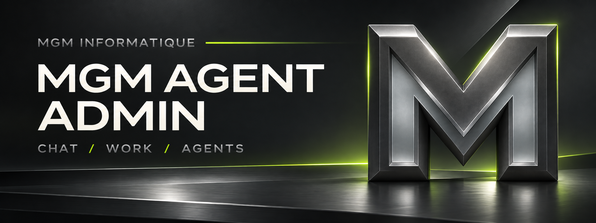

<p align="center">
  
</p>

<h2 align="center">Your ideas deserve to become projects.</h2>

<p align="center">
  <strong>Talk to AI. Work with your files. Take the next step.</strong><br>
  MGM Agent Admin brings your models, projects and local work into one space.
</p>

<p align="center">
  <a href="https://agent-ia.mgminformatique.ca"><strong>Try the web app ↗</strong></a>
  &nbsp; · &nbsp;
  <a href="https://mgminformatique.ca/en/applications/agent-ia/">Explore the features</a>
  &nbsp; · &nbsp;
  <a href="README.md">Français</a>
</p>

<p align="center">
  <a href="#help-mgm-grow"></a>
  <a href="#help-mgm-grow"></a>
  <a href="https://github.com/mgminformatique/mgm-agent-public/fork"></a>
  <a href="https://github.com/mgminformatique/mgm-agent-public/discussions"></a>
</p>

<p align="center"><sub>Web app available · Windows 64-bit · Public installer coming later</sub></p>

---

## AI that fits the way you work

A project to understand. A document to prepare. A task to carry out on your
computer. Start with a conversation, then continue with the tools and
permissions your work needs.

<table>
  <tr>
    <td width="50%" valign="top">
      <h3>💬 Chat — ask the right questions</h3>
      <p>Choose a model, explore an idea and return to your conversations. Models are grouped by provider so you can find your way around.</p>
    </td>
    <td width="50%" valign="top">
      <h3>🗂️ Projects — keep the context</h3>
      <p>Bring together your files, instructions and objective. Turn a broad request into concrete project steps.</p>
    </td>
  </tr>
  <tr>
    <td width="50%" valign="top">
      <h3>⌨️ MGM Work — work on your computer</h3>
      <p>Use an integrated terminal for commands and local work. MGM Work is included with the Ultra plan.</p>
    </td>
    <td width="50%" valign="top">
      <h3>🛡️ Agents — follow the actions</h3>
      <p>Review activity, results and approval requests. Actions use the permissions available to the application and connected accounts.</p>
    </td>
  </tr>
</table>

Available features and models depend on your plan and configured connections.
An MGM account and an Internet connection are required.

## A first idea to try

**Development** — understand a repository and plan a focused change.<br>
**IT** — organize a diagnostic process and review steps before acting.<br>
**Documentation** — turn notes into a clear, reusable guide.

```text
Help me understand this project. First summarize how it is organized,
identify what needs checking and propose a plan before changing anything.
```

**[Explore four starting examples →](EXAMPLES.md#english)**

## Get started

| 01 · Explore | 02 · Sign in | 03 · Set your goal |
| :--- | :--- | :--- |
| Discover [the application and its plans](https://mgminformatique.ca/en/applications/agent-ia/). | Open [MGM Agent](https://agent-ia.mgminformatique.ca) with your MGM account. | Choose your model and describe what you want to accomplish. |

Creating an account does not initiate a payment. Feature access depends on
the plan you choose.

> **The Windows installer will come to this repository later.**
> No executable or installation package is published here yet.
> Future versions will appear under [Releases](https://github.com/mgminformatique/mgm-agent-public/releases), with release notes and file verification information.

[Prepare for your Windows installation →](INSTALLATION.md#english)

## Help MGM grow

**Like the direction? Become one of the project’s early supporters.** A useful
suggestion, a clearer translation or feedback from your own workflow can help
shape the next step.

| Your action | What it contributes |
| :--- | :--- |
| **⭐ Star** at the top of this repository | Bookmark MGM Agent and show your support. |
| **🔔 Watch → Custom → Releases** | Receive notifications about future releases published here. |
| **🔀 [Fork](https://github.com/mgminformatique/mgm-agent-public/fork)** | Improve documentation, contribute a translation or suggest a usage example. |
| **💬 [Discussions](https://github.com/mgminformatique/mgm-agent-public/discussions)** | Share ideas, questions and the work you would like to accomplish. |
| **➕ [Follow MGM Informatique](https://github.com/mgminformatique)** | Find the team on GitHub and follow its public projects. |

**You do not need to be a developer to contribute.**
The [contribution guide](CONTRIBUTING.md#english) walks you through a first change.

This repository contains the public overview, guides and feedback space.
Forking it copies those materials; the proprietary application source code
is not published here.

## A problem or an idea?

[Report a problem](https://github.com/mgminformatique/mgm-agent-public/issues/new?template=bug_report.yml)
· [Suggest an improvement](https://github.com/mgminformatique/mgm-agent-public/issues/new?template=feature_request.yml)
· [Join the discussion](https://github.com/mgminformatique/mgm-agent-public/discussions)

Conversations are public. Remove personal information, keys and confidential
documents from your examples.

<details>
<summary><strong>Frequently asked questions</strong></summary>

### Can I already use MGM Agent?

Yes, [the web app](https://agent-ia.mgminformatique.ca) is available. Agent
features depend on your account and plan. This repository’s future Windows
installer is not available yet.

### Is this an open-source application?

MGM Agent Admin is proprietary. This is its public overview, documentation and
feedback repository. Contributions to these materials are welcome.

### How do I follow the Windows release?

Choose **Watch → Custom → Releases** on GitHub. Starring helps you find the
repository again; watching releases subscribes you to their publication.

### Are external accounts included?

Supported services require their own connection and their owner’s permission.
Availability depends on your account configuration.

</details>

---

<p align="center">
  <br>
  <strong>An idea. A project. MGM Informatique.</strong><br><br>
  <a href="https://mgminformatique.ca">Our website</a>
  &nbsp; · &nbsp;
  <a href="https://github.com/mgminformatique">MGM on GitHub</a>
  &nbsp; · &nbsp;
  <a href="NOTICE.md">Notice</a>
</p>
