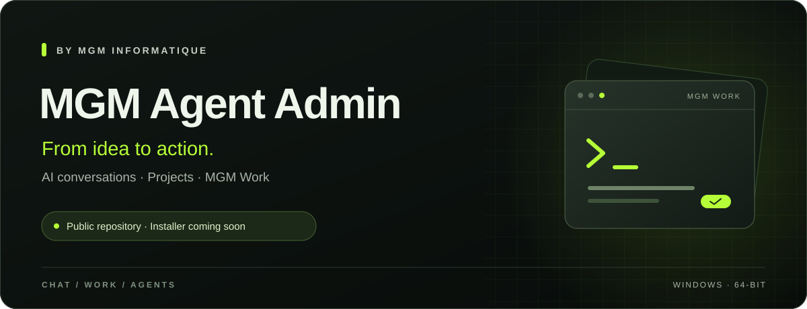

  

  <strong>Your AI agent. Your projects. Your desktop.</strong> 
  A Windows application by MGM Informatique.

  <a href="https://mgminformatique.ca/en/applications/agent-ia/">Discover MGM Agent</a>
  &nbsp;·&nbsp;
  <a href="https://agent-ia.mgminformatique.ca">Open the web app</a>
  &nbsp;·&nbsp;
  <a href="README.md">Français</a>

---

> **Windows installer: coming soon.**
> This repository contains the MGM Agent Admin overview, documentation and public feedback.
> No executable or installation package has been published here yet.

## One space to get things done

MGM Agent Admin brings AI conversations, project tracking and work on your
computer together in its Graphite interface. Choose your model, follow the
agent’s activity and control its actions.

| 💬 AI conversations | 🗂️ Projects and files | 🛡️ Actions and permissions |
| :--- | :--- | :--- |
| Choose your models and return to your conversations. | Work with documents and projects in one place. | Follow activity and respond to approval requests. |

| ⌨️ MGM Work | 🔌 Connected accounts | 👤 Your MGM account |
| :--- | :--- | :--- |
| A terminal for commands and local work, included with Ultra. | Use supported services with the permissions you grant. | Access your account and manage your subscription. |

Available features depend on your plan and account permissions. External
services require their own connection.

## Future Windows downloads

The first installer published in this repository will appear under
[Releases](https://github.com/mgminformatique/mgm-agent-public/releases),
along with release notes and file verification information.

| Planned platform | Status in this repository |
| :--- | :--- |
| Windows 64-bit | Installer coming soon |

An MGM account and an Internet connection are required for online services.
Creating an account does not initiate a payment.

[Prepare for your first installation →](INSTALLATION.md#english)

## Share your feedback

- [Report a problem](https://github.com/mgminformatique/mgm-agent-public/issues/new?template=bug_report.yml) with your version, steps and observed result.
- [Suggest an improvement](https://github.com/mgminformatique/mgm-agent-public/issues/new?template=feature_request.yml) by explaining what you want to accomplish.
- Follow future publications using **Watch → Custom → Releases** on GitHub.

Issues are public. Remove personal information, passwords, keys and confidential
documents from your examples.

---

   
  <strong>MGM Informatique</strong> 
  <a href="https://mgminformatique.ca">mgminformatique.ca</a>

MGM Agent Admin is proprietary software. This public repository introduces
the application and will host its Windows distributions. [Notice](NOTICE.md)
