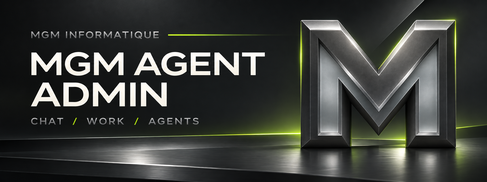
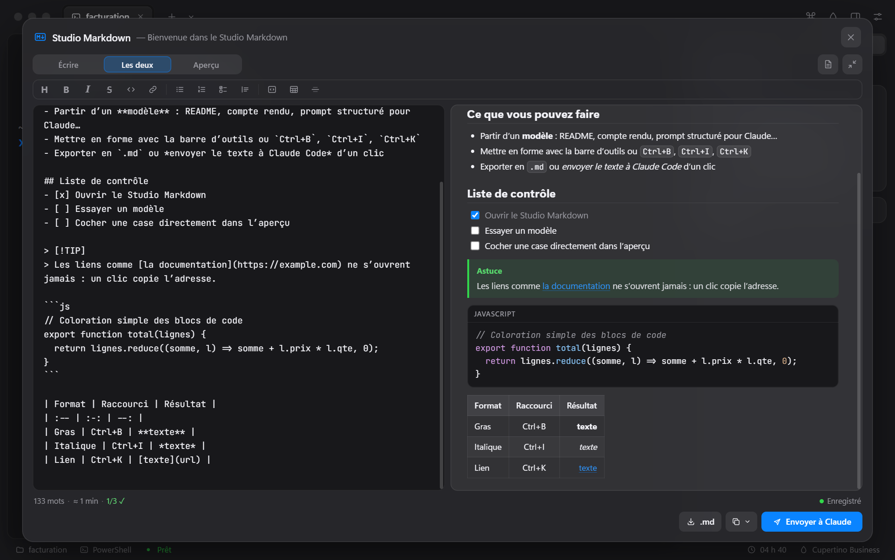
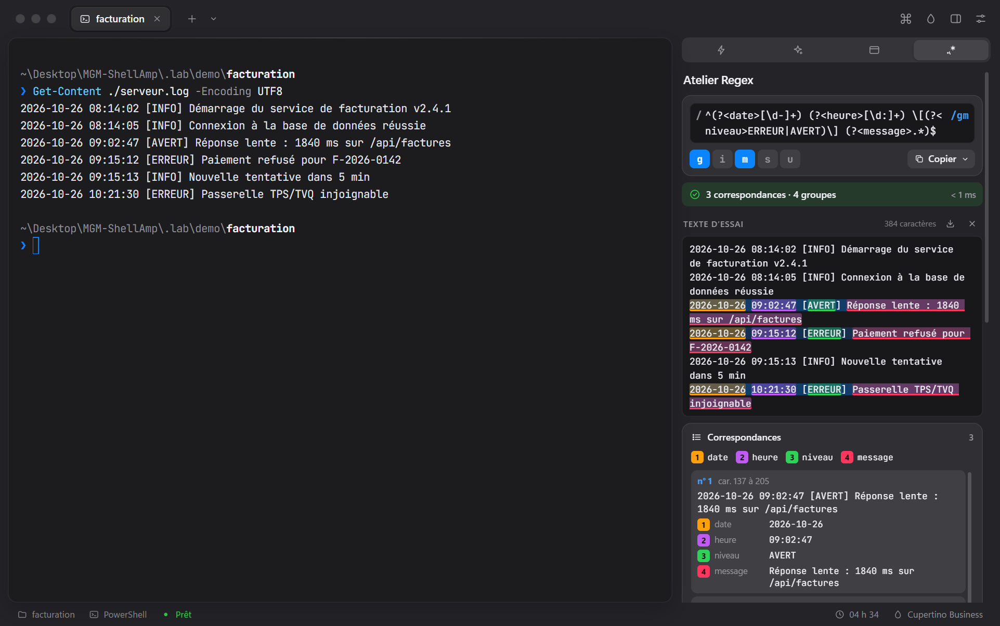
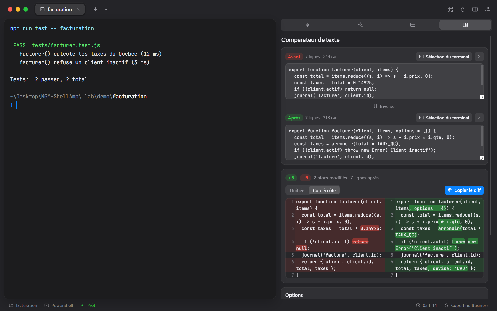
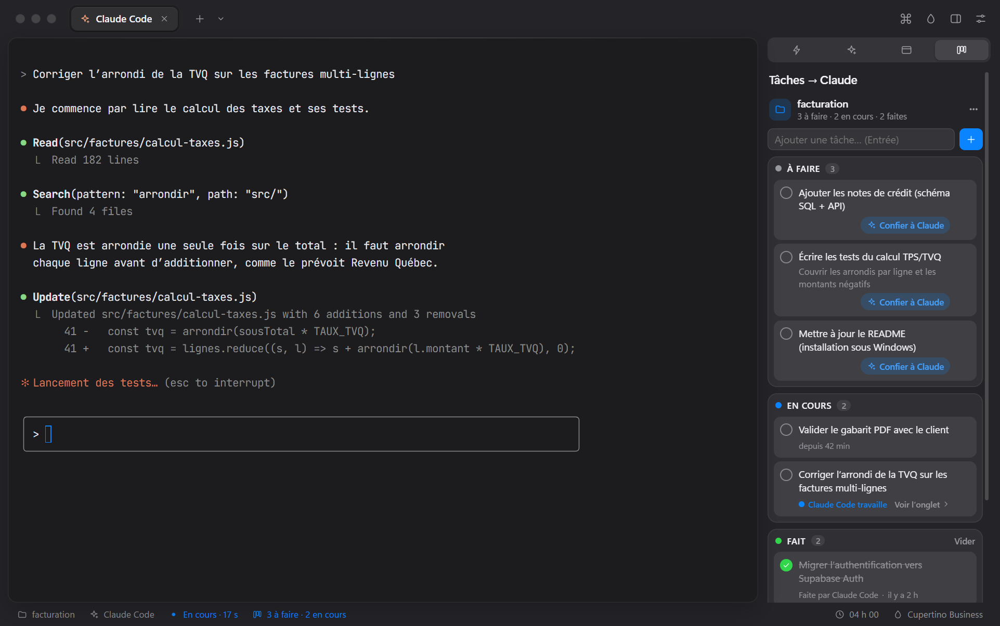

<p align="center">
  
</p>

<h2 align="center">Vos idées méritent de devenir des projets.</h2>

<p align="center">
  <strong>Discutez avec l’IA. Travaillez sur vos fichiers. Passez à l’action.</strong><br>
  MGM Agent Admin rassemble vos modèles, vos projets et votre travail local dans un même espace.
</p>

<p align="center">
  <a href="https://agent-ia.mgminformatique.ca"><strong>Essayer l’application web ↗</strong></a>
  &nbsp; · &nbsp;
  <a href="https://mgminformatique.ca/applications/agent-ia/">Découvrir les fonctionnalités</a>
  &nbsp; · &nbsp;
  <a href="README.md">English</a>
</p>

<p align="center">
  <a href="#faire-grandir-mgm-ensemble"></a>
  <a href="#faire-grandir-mgm-ensemble"></a>
  <a href="https://github.com/mgminformatique/mgm-agent-public/fork"></a>
  <a href="https://github.com/mgminformatique/mgm-agent-public/discussions"></a>
</p>

<p align="center"><sub>Application web accessible · Windows 64 bits · Installateur public à venir</sub></p>

---

## L’IA, dans votre façon de travailler

Un projet à comprendre. Un document à préparer. Une tâche à réaliser sur votre
ordinateur. MGM Agent Admin vous permet de commencer par une conversation,
puis de poursuivre le travail avec les outils et les autorisations adaptés.

<table>
  <tr>
    <td width="50%" valign="top">
      <h3>💬 Chat — poser les bonnes questions</h3>
      <p>Choisissez un modèle, explorez une idée et retrouvez vos échanges. Le sélecteur organise les modèles par fournisseur pour vous aider à vous repérer.</p>
    </td>
    <td width="50%" valign="top">
      <h3>🗂️ Projets — garder le contexte</h3>
      <p>Rassemblez vos fichiers, vos consignes et votre objectif. Passez de la demande générale aux étapes concrètes du projet.</p>
    </td>
  </tr>
  <tr>
    <td width="50%" valign="top">
      <h3>⌨️ MGM Work — travailler sur le poste</h3>
      <p>Retrouvez un terminal intégré pour les commandes et le travail local. MGM Work est inclus avec le forfait Ultra.</p>
    </td>
    <td width="50%" valign="top">
      <h3>🛡️ Agents — suivre les actions</h3>
      <p>Consultez l’activité, les résultats et les demandes d’approbation. Les actions utilisent les autorisations de l’application et des comptes connectés.</p>
    </td>
  </tr>
</table>

Les fonctionnalités et les modèles disponibles dépendent du forfait et des
connexions configurées. Un compte MGM et une connexion Internet sont nécessaires.

## Choisir son modèle

Le sélecteur regroupe les modèles par compagnie, avec les icônes du fournisseur
et du modèle, une recherche et des familles faciles à parcourir. Choisissez
un mode MGM **Auto, Standard, Pro ou Max**, ou un modèle disponible dans le
catalogue. L’effort de réflexion est réglable lorsque le modèle le permet.

| Compagnie | Familles représentées dans le catalogue |
| :--- | :--- |
| **OpenAI** | GPT, dont Astra, Sol et Luna ; familles Codex |
| **Anthropic** | Claude : Fable, Opus, Sonnet et Haiku |
| **Google** | Gemini : Argon, Carbon, Hydrogen et Flash |
| **xAI · DeepSeek · Moonshot AI** | Grok, DeepSeek V et R, Kimi |
| **Z.ai · Alibaba · MiniMax** | GLM, Qwen, familles MiniMax M |
| **Meta · Mistral AI** | Llama et familles Mistral |

MGM prend en charge OpenRouter, les connexions directes OpenAI et Anthropic,
les offres d’inférence Hugging Face compatibles et des serveurs d’inférence
autorisés par l’administrateur. Les profils nommés permettent de conserver
plusieurs configurations selon le rôle de l’agent.

Les choix réellement accessibles apparaissent dans l’application et dépendent
du forfait et des connexions. Images, PDF, réflexion et outils dépendent du
modèle choisi. Les points et budgets MGM continuent de s’appliquer avec une
clé API personnelle ; la facturation du fournisseur reste distincte.

## ShellAmp devient MGM Work dans Agent Admin

**MGM Work est l’espace ShellAmp intégré à Agent Admin et inclus avec Ultra.**
Il réunit les onglets de terminal, les agents, les outils de projet et une
bibliothèque de **50 extensions et thèmes**.

- Ouvrez un projet dans MGM, PowerShell, Codex, Claude Code ou GitHub Copilot,
  selon les logiciels et comptes dont vous disposez.
- Retrouvez les dépôts du connecteur GitHub et clonez-les dans votre espace.
- Utilisez les suggestions de commandes `/`, la complétion Tab, le choix du
  modèle et de l’effort, ainsi que la saisie multiligne du prompt MGM.
- Gardez les notes, les tâches, les comparaisons et les outils à côté du terminal.
- Personnalisez les thèmes, les onglets, les espaces de travail et les alertes.

La bibliothèque **Supreme** réunit **7 619 entrées de catalogue**, dont
521 recettes guidées et 7 098 références de commandes, réparties dans
70 familles d’outils, avec 40 scénarios et 10 packs. Les logiciels tiers
référencés demandent leur propre installation et configuration.

### Des applications directement dans ShellAmp

| Application ou outil | Utilité |
| :--- | :--- |
| **Studio Markdown** | Rédiger, prévisualiser et exporter un document. |
| **Atelier Regex** | Tester les motifs, les groupes et les remplacements. |
| **Comparateur de texte** | Examiner les différences entre deux versions. |
| **Boîte à outils dev** | JSON, Base64, URL, UUID, empreintes et horodatages. |
| **Nuancier et calculatrice dev** | Palettes, contraste, conversions et calculs. |
| **Tableau de tâches et notes de projet** | Organiser le travail et transmettre une tâche à Claude Code. |
| **Bibliothèque de prompts et projets favoris** | Retrouver ses demandes et ses dossiers. |
| **Commit Studio et assistant cron** | Préparer ses messages de commit et ses expressions de planification. |
| **Journal de session et alertes** | Retrouver la sortie et suivre les événements. |
| **Pomodoro, ambiance et horloges** | Garder un rythme de travail et suivre les fuseaux horaires. |

Les sessions MGM utilisent le compte Agent Admin, ses points et ses
approbations. Codex, Claude Code et Copilot conservent leur programme officiel,
leur connexion et leur abonnement propres.

**[Découvrir le guide ShellAmp détaillé, en anglais →](SHELLAMP.md)**

## Voir l’interface

Ces captures proviennent de la galerie de démonstration fournie avec ShellAmp.
Elles montrent l’interface française, le thème Cupertino et des exemples de
projet. MGM Work propose également le thème Graphite. Cliquez pour agrandir.

<table>
  <tr>
    <td width="50%"><a href="assets/screenshots/shellamp-markdown-studio.png"></a><p><strong>Studio Markdown</strong> — rédaction et aperçu.</p></td>
    <td width="50%"><a href="assets/screenshots/shellamp-regex-lab.png"></a><p><strong>Atelier Regex</strong> — motifs et correspondances.</p></td>
  </tr>
  <tr>
    <td width="50%"><a href="assets/screenshots/shellamp-diff-compare.png"></a><p><strong>Comparateur</strong> — changements côte à côte.</p></td>
    <td width="50%"><a href="assets/screenshots/shellamp-task-board.png"></a><p><strong>Tableau de tâches</strong> — travail et agent réunis.</p></td>
  </tr>
</table>

## Connecteurs, plugins et services

Le catalogue **Connexions & plugins** propose GitHub, Netlify, Supabase,
Docker Hub, Microsoft 365, GoDaddy, Stripe, Google Cloud et Gmail. Reliez
votre compte avec les droits utiles à la tâche ; les actions restent soumises
aux permissions du service et aux approbations MGM. Un service présent au
catalogue n’est pas automatiquement connecté.

Les serveurs **MCP** compatibles permettent d’ajouter des outils sélectionnés.
Sur Windows, MGM peut découvrir les plugins installés de **Codex et Claude
Code**, lire leurs skills et utiliser les outils locaux compatibles, ou ouvrir
l’agent officiel. L’import d’un paquet depuis un dossier ou un dépôt GitHub
public ne lance pas automatiquement ses scripts ni ses dépendances.

ShellAmp propose aussi **Microsoft, Twitch, Spotify, Deezer, SoundCloud, Steam,
Xbox, Facebook et les lecteurs Windows** : API avec connexion, contrôle d’un
lecteur local ou ouverture du service officiel, selon le connecteur.
Par exemple, Steam lance les jeux installés et Facebook ouvre les pages
officielles et Business Suite. Les abonnements tiers restent distincts.

[Voir les capacités de chaque connecteur →](SHELLAMP.md#media-and-everyday-connectors)

## Une première idée à essayer

**Développement** — comprendre un dépôt et préparer une modification ciblée.<br>
**TI** — organiser un diagnostic et vérifier les étapes avant d’agir.<br>
**Documentation** — transformer des notes en guide clair et réutilisable.

```text
Aide-moi à comprendre ce projet. Commence par résumer son organisation,
repère les points à vérifier et propose un plan avant toute modification.
```

**[Voir quatre exemples pour démarrer →](EXAMPLES.md)**

## Commencer avec MGM Agent

| 01 · Découvrir | 02 · Se connecter | 03 · Définir son objectif |
| :--- | :--- | :--- |
| Consultez [l’application et ses forfaits](https://mgminformatique.ca/applications/agent-ia/). | Ouvrez [MGM Agent](https://agent-ia.mgminformatique.ca) avec votre compte MGM. | Choisissez votre modèle et décrivez ce que vous souhaitez accomplir. |

La création du compte ne déclenche aucun paiement. L’accès aux fonctionnalités
dépend du forfait choisi.

> **L’installateur Windows arrive dans ce dépôt plus tard.**
> Aucun EXE ni paquet d’installation n’est publié ici pour le moment.
> Les futures versions seront annoncées dans [Releases](https://github.com/mgminformatique/mgm-agent-public/releases), avec leurs notes et les informations de vérification du fichier.

[Préparer votre installation Windows →](INSTALLATION.md)

## Faire grandir MGM, ensemble

**Le projet vous parle ? Rejoignez ses premiers soutiens.** Une suggestion bien
expliquée, une traduction plus claire ou un retour d’usage peut faire avancer
la prochaine étape.

| Votre geste | Ce qu’il apporte |
| :--- | :--- |
| **⭐ Star** en haut du dépôt | Gardez MGM Agent dans vos favoris et montrez votre soutien au projet. |
| **🔔 Watch → Custom → Releases** | Recevez les notifications des futures versions publiées ici. |
| **🔀 [Fork](https://github.com/mgminformatique/mgm-agent-public/fork)** | Proposez une amélioration de la documentation, une traduction ou un exemple d’usage. |
| **💬 [Discussions](https://github.com/mgminformatique/mgm-agent-public/discussions)** | Partagez vos idées, vos questions et les tâches que vous aimeriez accomplir. |
| **➕ [Suivre MGM Informatique](https://github.com/mgminformatique)** | Retrouvez l’équipe sur GitHub et suivez ses projets publics. |

**Pas besoin d’être développeur pour contribuer.**
[Le guide de contribution](CONTRIBUTING.md) vous aide à proposer un premier changement.

Ce dépôt accueille la vitrine, les guides et les retours publics. Un fork porte
sur ces contenus ; le code source de l’application propriétaire n’est pas publié ici.

## Un problème ou une idée ?

[Signaler un problème](https://github.com/mgminformatique/mgm-agent-public/issues/new?template=bug_report.yml)
· [Proposer une amélioration](https://github.com/mgminformatique/mgm-agent-public/issues/new?template=feature_request.yml)
· [Échanger avec la communauté](https://github.com/mgminformatique/mgm-agent-public/discussions)

Les échanges sont publics : retirez les données personnelles, clés et documents
confidentiels de vos exemples.

<details>
<summary><strong>Questions fréquentes</strong></summary>

### Peut-on déjà utiliser MGM Agent ?

Oui, [l’application web](https://agent-ia.mgminformatique.ca) est accessible.
L’accès aux fonctions de l’agent dépend du compte et de son forfait. Le futur
installateur Windows de ce dépôt n’est pas encore disponible.

### Est-ce un projet open source ?

MGM Agent Admin est propriétaire. Ce dépôt est l’espace public de présentation,
de documentation et de retours. Les contributions à ces contenus sont les bienvenues.

### Comment suivre l’arrivée de l’EXE ?

Dans GitHub, choisissez **Watch → Custom → Releases**. Une étoile permet de
retrouver le dépôt ; l’abonnement aux releases sert à suivre leurs publications.

### Les comptes externes sont-ils inclus ?

Les services compatibles demandent leur propre connexion et les autorisations
de leur titulaire. Leur disponibilité dépend de la configuration du compte.

</details>

---

<p align="center">
  <br>
  <strong>Une idée. Un projet. MGM Informatique.</strong><br><br>
  <a href="https://mgminformatique.ca">Notre site</a>
  &nbsp; · &nbsp;
  <a href="https://github.com/mgminformatique">MGM sur GitHub</a>
  &nbsp; · &nbsp;
  <a href="NOTICE.md">Notice</a>
</p>
