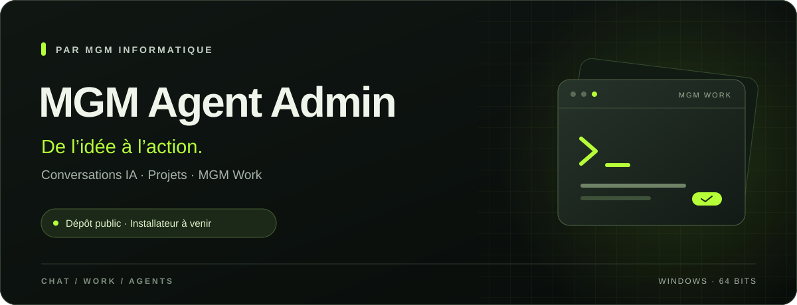

  

  <strong>Votre agent IA. Vos projets. Votre poste de travail.</strong> 
  Une application Windows par MGM Informatique.

  <a href="https://mgminformatique.ca/applications/agent-ia/">Découvrir MGM Agent</a>
  &nbsp;·&nbsp;
  <a href="https://agent-ia.mgminformatique.ca">Ouvrir l’application web</a>
  &nbsp;·&nbsp;
  <a href="README.en.md">English</a>

---

> **Installateur Windows : bientôt disponible.**
> Ce dépôt accueille la présentation, la documentation et les retours de MGM Agent Admin.
> Aucun EXE ni paquet d’installation n’y est publié pour le moment.

## Un espace pour passer à l’action

MGM Agent Admin réunit les conversations avec l’IA, le suivi de vos projets et
le travail sur votre ordinateur dans une interface Graphite. Vous choisissez
votre modèle, suivez l’activité de l’agent et gardez la main sur ses actions.

| 💬 Conversations IA | 🗂️ Projets et fichiers | 🛡️ Actions et autorisations |
| :--- | :--- | :--- |
| Choisissez vos modèles et retrouvez vos échanges. | Travaillez avec vos documents et vos projets dans le même espace. | Consultez l’activité et répondez aux demandes d’approbation. |

| ⌨️ MGM Work | 🔌 Comptes connectés | 👤 Votre compte MGM |
| :--- | :--- | :--- |
| Un terminal pour vos commandes et votre travail local, inclus avec Ultra. | Utilisez les services compatibles avec les droits que vous leur accordez. | Retrouvez votre accès et la gestion de votre abonnement. |

Les fonctionnalités disponibles dépendent du forfait et des autorisations de
votre compte. Les services externes nécessitent leur propre connexion.

## Le futur téléchargement Windows

La première publication de l’installateur dans ce dépôt sera annoncée dans
[Releases](https://github.com/mgminformatique/mgm-agent-public/releases), avec
ses notes de version et les informations de vérification du fichier.

| Plateforme prévue | État dans ce dépôt |
| :--- | :--- |
| Windows 64 bits | Installateur à venir |

Un compte MGM et une connexion Internet sont nécessaires pour utiliser les
services en ligne. La création du compte ne déclenche aucun paiement.

[Préparer votre première installation →](INSTALLATION.md)

## Vos retours font avancer MGM Agent

- [Signaler un problème](https://github.com/mgminformatique/mgm-agent-public/issues/new?template=bug_report.yml) avec la version, les étapes et le résultat observé.
- [Proposer une amélioration](https://github.com/mgminformatique/mgm-agent-public/issues/new?template=feature_request.yml) en expliquant ce que vous souhaitez accomplir.
- Suivre les futures publications avec **Watch → Custom → Releases** sur GitHub.

Les tickets sont publics : retirez les données personnelles, mots de passe,
clés et documents confidentiels de vos exemples.

---

   
  <strong>MGM Informatique</strong> 
  <a href="https://mgminformatique.ca">mgminformatique.ca</a>

MGM Agent Admin est un logiciel propriétaire. Ce dépôt public présente
l’application et accueillera ses distributions Windows. [Notice](NOTICE.md)
