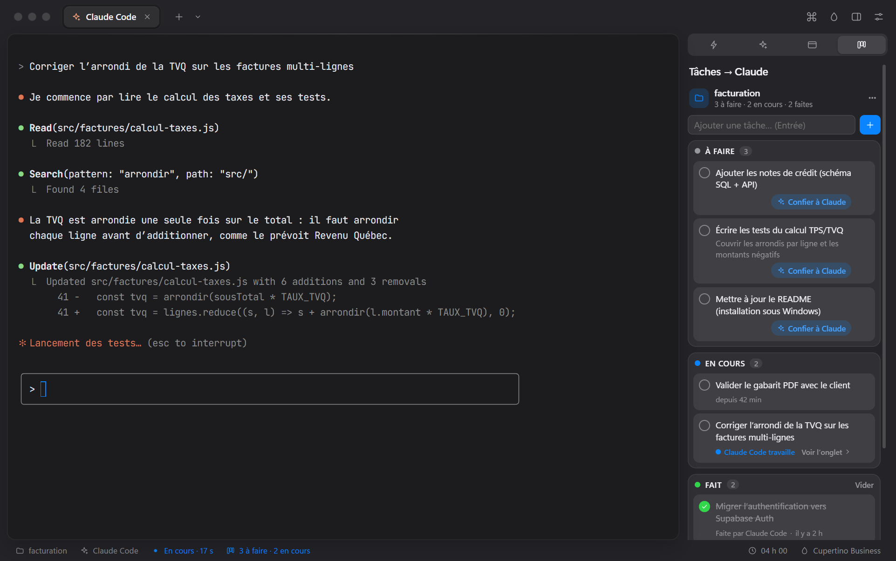

<p align="center">
  
</p>

<h2 align="center">Your models. Your tools. Your next project.</h2>

<p align="center">
  <strong>From a conversation to work you can review.</strong><br>
  MGM Agent Admin brings AI conversations, project context, connected services<br>
  and the ShellAmp desktop workspace together.
</p>

<p align="center">
  <a href="https://github.com/mgminformatique/mgm-agent-public/releases/download/v1.4.2/Agent-Admin-1.4.2-x64.exe"><strong>Download for Windows ↗</strong></a>
  &nbsp; · &nbsp;
  <a href="https://agent-ia.mgminformatique.ca"><strong>Try the web app ↗</strong></a>
  &nbsp; · &nbsp;
  <a href="https://mgminformatique.ca/en/applications/agent-ia/">Features & plans</a>
  &nbsp; · &nbsp;
  <a href="README.fr.md">Français</a>
</p>

<p align="center">
  <a href="#help-mgm-grow"></a>
  <a href="#help-mgm-grow"></a>
  <a href="https://github.com/mgminformatique/mgm-agent-public/fork"></a>
  <a href="https://github.com/mgminformatique/mgm-agent-public/discussions"></a>
</p>

<p align="center"><sub>Windows x64 installer available · Version 1.4.2 · Web app available</sub></p>

<p align="center">
  <a href="#what-you-can-do">Features</a> ·
  <a href="#choose-your-model">Models</a> ·
  <a href="#shellamp-meet-mgm-work">ShellAmp</a> ·
  <a href="#see-the-interface">Screenshots</a> ·
  <a href="#connect-your-services">Connectors</a> ·
  <a href="#get-started">Get started</a>
</p>

---

## What you can do

Understand a codebase. Prepare a document. Investigate a technical problem.
Bring your project context into a conversation, then use the tools needed to
move it forward.

<table>
  <tr>
    <td width="50%" valign="top">
      <h3>💬 Chat & models</h3>
      <p>Choose your model, attach supported images, PDFs or text files, and return to your conversation history. Browse models by company, with provider and model icons.</p>
    </td>
    <td width="50%" valign="top">
      <h3>🗂️ Projects & context</h3>
      <p>Keep files, instructions and objectives together. Use project context, reusable skills and specialized agent roles to make your request more precise.</p>
    </td>
  </tr>
  <tr>
    <td width="50%" valign="top">
      <h3>⌨️ Local work & terminal</h3>
      <p>Read and edit local files, run commands and work in a project folder through the desktop application. Open MGM Work, the ShellAmp workspace included with Ultra.</p>
    </td>
    <td width="50%" valign="top">
      <h3>🛡️ Missions you can follow</h3>
      <p>Set a mission objective and point budget, follow tool activity and results, respond to approval requests, and stop or resume work with its saved history.</p>
    </td>
  </tr>
</table>

The web app and Windows desktop share the MGM experience; local terminal and
desktop integrations require Windows. Model capabilities, point limits and
feature access depend on your plan and configured connections.

## Choose your model

The model picker groups companies and model families, adds their visual
identities, and lets you search for a specific model. Choose an MGM mode
(**Auto, Standard, Pro or Max**) or an available model from the catalog.
Where supported, adjust reasoning effort for the task.

| Company | Model families represented in the catalog |
| :--- | :--- |
| **OpenAI** | GPT, including Astra, Sol and Luna; Codex families |
| **Anthropic** | Claude, including Fable, Opus, Sonnet and Haiku |
| **Google** | Gemini, including Argon, Carbon, Hydrogen and Flash |
| **xAI** | Grok |
| **DeepSeek** | DeepSeek V and R families |
| **Moonshot AI** | Kimi |
| **Z.ai** | GLM |
| **Alibaba** | Qwen |
| **MiniMax** | MiniMax M families |
| **Meta** | Llama |
| **Mistral AI** | Mistral families |

MGM supports **OpenRouter**, direct **OpenAI** and **Anthropic** connections,
supported **Hugging Face inference** offers, and administrator-approved
compatible inference servers. Named connection profiles let you keep different
model setups for different roles.

This is a selection of catalog families, not a promise that every model is
available to every account. The in-app picker shows your current choices.
Images, PDFs, reasoning and tool use depend on the selected model and route.
MGM points and mission budgets still apply when using a personal API connection;
provider billing and subscriptions remain separate.

## ShellAmp: meet MGM Work

**ShellAmp is the desktop workspace integrated into MGM Agent as MGM Work.**
It combines terminal tabs, AI agent profiles, project tools and a library of
**50 included extensions and themes** with the Ultra plan.

- **Choose your working environment:** MGM's own agent, PowerShell, Codex,
  Claude Code or GitHub Copilot, with the relevant software and account access.
- **Stay in your project:** launch sessions in the selected folder, browse
  connected GitHub repositories and clone a repository into your workspace.
- **Work from the prompt:** model selection, reasoning effort, slash-command
  suggestions, Tab completion and multiline input in the MGM prompt.
- **Keep useful tools nearby:** notes, prompts, text comparison, Markdown,
  task tracking and development utilities inside the same workspace.
- **Make it yours:** Graphite and other themes, colored tabs, saved workspaces,
  command shortcuts, activity notifications and focus tools.

The **Supreme command library** contains **7,619 catalog entries across 70 tool
families**, including guided recipes and command references, plus **40 scenarios
and 10 packs**. Search, review the instructions and fill in the relevant inputs.
Referenced third-party tools need their own installation and configuration.

MGM sessions use the Agent Admin account, models, points and approvals.
Codex, Claude Code and Copilot use their official programs and their own account
access. Their subscriptions are not bundled with MGM.

### Apps inside ShellAmp

| Built-in app or tool | What you can do |
| :--- | :--- |
| **Markdown Studio** | Write with a live preview, use templates and export Markdown. |
| **Regex Lab** | Test patterns, inspect matching groups and preview replacements. |
| **Text Diff** | Compare text or configuration files in unified or side-by-side views. |
| **Developer Toolbox** | Work with JSON, Base64, URLs, UUIDs, hashes and timestamps. |
| **Color Studio** | Convert colors, build palettes and check contrast. |
| **Developer Calculator** | Calculate with decimal, hexadecimal, binary and other developer formats. |
| **Task Board & Project Notes** | Organize project tasks and decisions; hand a task to Claude Code. |
| **Prompt Library & Project Launcher** | Reuse prompts and open your favorite project folders. |
| **Commit Studio & Cron Builder** | Prepare commit messages and scheduling expressions. |
| **Session Transcript & Output Alerts** | Search terminal output and notice matching events. |
| **Pomodoro, Focus Ambience & World Clocks** | Keep your work rhythm and time zones in view. |

**[Explore ShellAmp's tools, media connections and workflow →](SHELLAMP.md)**

## See the interface

These screenshots come from ShellAmp's bundled demonstration gallery. They
show the French interface with the Cupertino theme; MGM Work also includes
Graphite. Sample projects and terminal output illustrate the tools.
Click an image to open it at full size.

<table>
  <tr>
    <td width="50%" valign="top">
      <a href="assets/screenshots/shellamp-markdown-studio.png"></a>
      <p><strong>Markdown Studio</strong><br>Write and preview your documentation side by side.</p>
    </td>
    <td width="50%" valign="top">
      <a href="assets/screenshots/shellamp-regex-lab.png"></a>
      <p><strong>Regex Lab</strong><br>Inspect matches while keeping the terminal in view.</p>
    </td>
  </tr>
  <tr>
    <td width="50%" valign="top">
      <a href="assets/screenshots/shellamp-diff-compare.png"></a>
      <p><strong>Text Diff</strong><br>Review changes in a visual comparison.</p>
    </td>
    <td width="50%" valign="top">
      <a href="assets/screenshots/shellamp-task-board.png"></a>
      <p><strong>Task Board</strong><br>Keep tasks and an agent session in the same workspace.</p>
    </td>
  </tr>
</table>

## Connect your services

### Services for your agents

The **Connections & plugins** catalog includes:

| Service | Supported area of work |
| :--- | :--- |
| **GitHub** | Repositories, files, branches, pull requests, issues and Actions. |
| **Netlify** | Sites, deployments, domains and DNS. |
| **Supabase** | Projects, SQL, migrations and Edge Functions. |
| **Docker Hub** | Image repositories and tags. |
| **Microsoft 365** | Organization administration through Microsoft Graph. |
| **GoDaddy** | Domains and DNS records. |
| **Stripe** | Customers, subscriptions, products, prices and webhooks. |
| **Google Cloud** | Projects and APIs through a configured service account. |
| **Gmail** | Send email with your approval. |

Connect your own account and grant the permissions needed for your task.
Available actions depend on the service, account rights and MGM approvals.
Being listed in the catalog does not mean an account is already connected.

### Plugins, skills and MCP

Add supported remote **MCP** servers, choose their tools and enable the
connections you need. On Windows, discover installed **Codex and Claude Code
plugins**, read their skills and use supported local MCP tools or open the
official agent. Import supported plugin packages from a folder or public
GitHub repository. Importing a package does not automatically install its
dependencies or run its scripts.

### Music, streaming and everyday apps in ShellAmp

ShellAmp also has connections for **Microsoft, Twitch, Spotify, Deezer,
SoundCloud, Steam, Xbox, Facebook and Windows media players**. Their functions
vary: some use an authenticated API, some control a local player, and others
open the service's official app or website.

For example, Microsoft can expose OneDrive, calendar and To Do actions after
setup; Spotify supports local playback control and optional Spotify Connect;
Steam can launch detected installed games. Facebook opens the official pages
and Business Suite. See the [connector details](SHELLAMP.md#media-and-everyday-connectors)
for what each connection actually provides.

## Get started

| 01 · Explore | 02 · Sign in | 03 · Set your goal |
| :--- | :--- | :--- |
| Discover [the application and its plans](https://mgminformatique.ca/en/applications/agent-ia/). | Open [MGM Agent](https://agent-ia.mgminformatique.ca) with your MGM account. | Choose your model and describe what you want to accomplish. |

Try a first request:

```text
Help me understand this project. Summarize how it is organized,
identify what needs checking and propose a plan before changing anything.
```

**[Explore four starting examples →](EXAMPLES.md#english)**

> **Download MGM Agent Admin & MGM Work 1.4.2 for Windows x64.**
> The [release](https://github.com/mgminformatique/mgm-agent-public/releases/tag/v1.4.2) includes the installer, its detached update signature and SHA-256 checksums.
> Read the [release notes](RELEASE-1.4.2.md) for the installation fix and verification details.

[Install on Windows →](INSTALLATION.md#english)

## Help MGM grow

**Become one of the project's early supporters.** Share a useful workflow,
suggest an improvement or help make the documentation clearer.

| Your action | What it contributes |
| :--- | :--- |
| **⭐ Star** at the top of this repository | Bookmark MGM Agent and show your support. |
| **🔔 Watch → Custom → Releases** | Receive notifications about future releases published here. |
| **🔀 [Fork](https://github.com/mgminformatique/mgm-agent-public/fork)** | Improve documentation, contribute a translation or suggest an example. |
| **💬 [Discussions](https://github.com/mgminformatique/mgm-agent-public/discussions)** | Share ideas, questions and feedback from your workflow. |
| **➕ [Follow MGM Informatique](https://github.com/mgminformatique)** | Follow the team's public projects on GitHub. |

You do not need to be a developer to contribute. Start with the
[contribution guide](CONTRIBUTING.md#english).

This repository contains the public overview, guides and feedback space.
Forking it copies these materials; **the proprietary application source code
is not published here**.

## A problem or an idea?

[Report a problem](https://github.com/mgminformatique/mgm-agent-public/issues/new?template=bug_report.yml)
· [Suggest an improvement](https://github.com/mgminformatique/mgm-agent-public/issues/new?template=feature_request.yml)
· [Join the discussion](https://github.com/mgminformatique/mgm-agent-public/discussions)

Conversations are public. Remove personal information, keys and confidential
documents from your examples.

<details>
<summary><strong>Frequently asked questions</strong></summary>

### Can I already use MGM Agent?

Yes. Use [the web app](https://agent-ia.mgminformatique.ca) or download the
[Windows x64 installer](https://github.com/mgminformatique/mgm-agent-public/releases/tag/v1.4.2).
Features depend on your account and plan.

### How are ShellAmp and MGM Work related?

MGM Work is the ShellAmp workspace integrated with Agent Admin and included
with Ultra. It provides desktop terminal sessions, tools, extensions and themes.

### Are model and external-service subscriptions included?

Access is determined by your MGM plan and connections. Third-party services,
personal API usage and official Codex, Claude Code or Copilot subscriptions
keep their own billing and requirements.

### Is this open source?

MGM Agent Admin is proprietary. This public repository welcomes contributions
to its documentation, translations and usage examples. See [the notice](NOTICE.md).

### How do I follow future Windows releases?

Choose **Watch → Custom → Releases** on GitHub. A star bookmarks the project;
watching releases subscribes you to their publication.

</details>

---

<p align="center">
  <br>
  <strong>An idea. A project. MGM Informatique.</strong><br><br>
  <a href="https://mgminformatique.ca">Our website</a>
  &nbsp; · &nbsp;
  <a href="https://github.com/mgminformatique">MGM on GitHub</a>
  &nbsp; · &nbsp;
  <a href="NOTICE.md">Notice</a>
</p>
