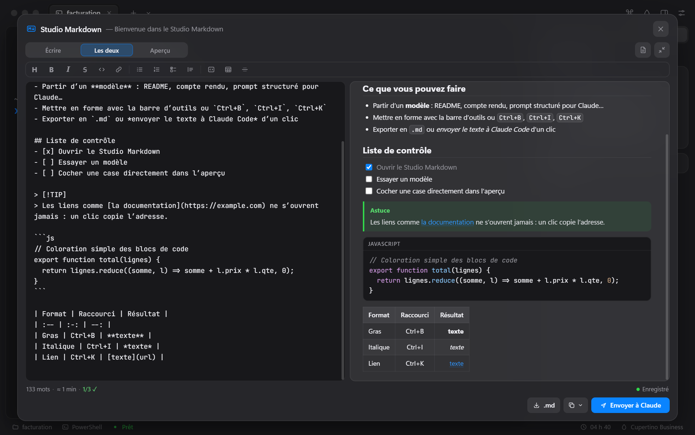
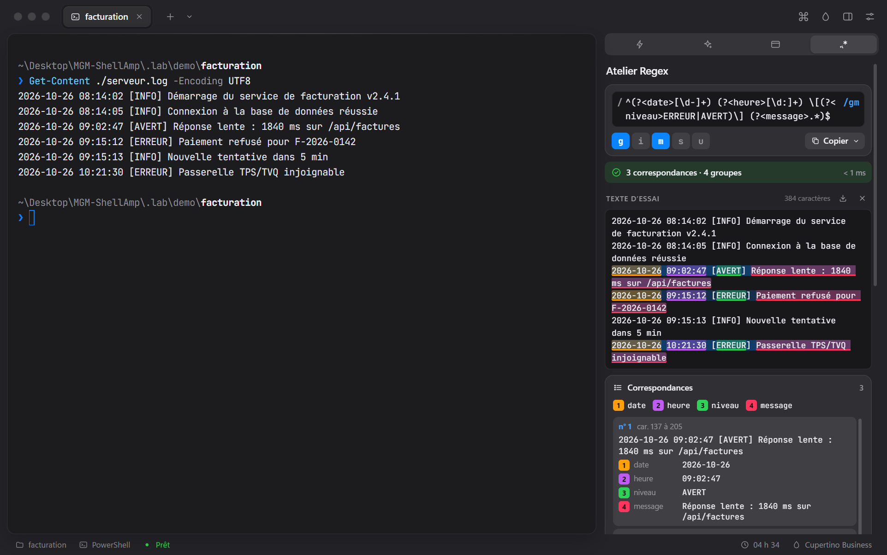
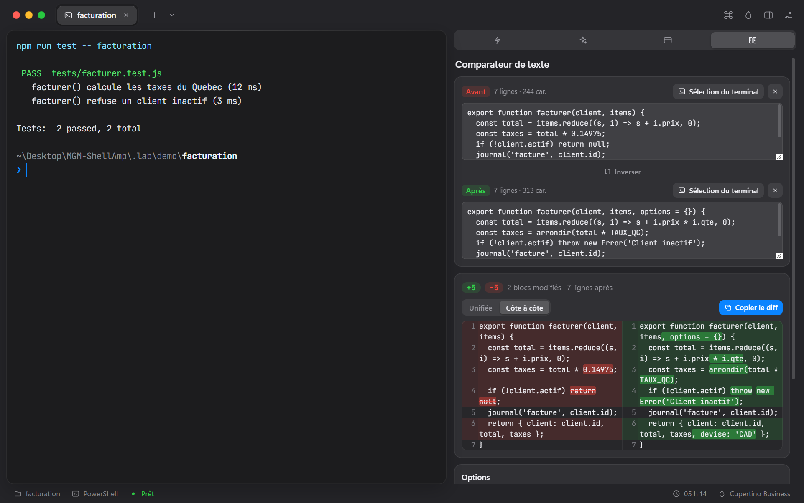
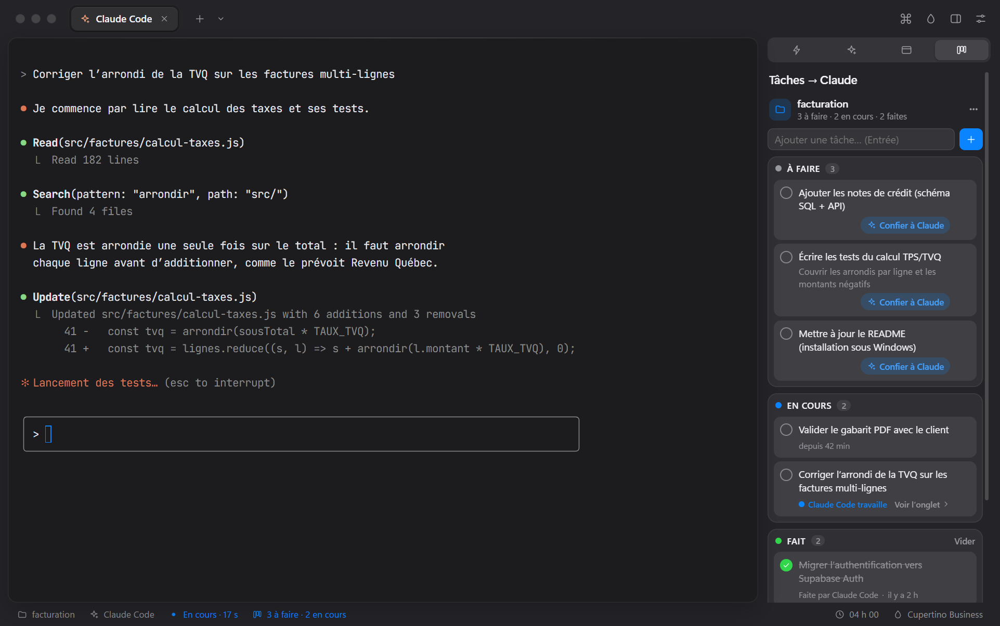

# ShellAmp inside MGM Agent

[← Back to MGM Agent](README.md) · [Présentation française](README.fr.md)

**MGM Work is the ShellAmp workspace integrated with Agent Admin.** It is
included with Ultra and brings terminal sessions, agent profiles, project
tools, extensions and themes into one Windows workspace.

## From a project to a working session

1. Open MGM Work from Agent Admin and select your project folder.
2. Choose MGM, PowerShell, Codex, Claude Code or Copilot according to your setup.
3. Use the sidebar, command palette and app panels alongside your terminal.
4. Review the result, keep your notes and continue from the same project.

MGM's prompt supports `/model`, `/effort`, `/permissions`, `/status`, `/resume`,
`/new`, `/skills`, `/mcp`, `/diff`, `/compact` and `/help`. Slash suggestions,
Tab completion and multiline input make commands easier to find and edit.
The shortcuts adapt to the active agent; command support differs between
MGM, Codex and Claude Code.

MGM sessions use the Agent Admin account and its point budgets, tools and
approval flow. Official agents use their own sign-in and entitlements.
Codex and Copilot CLI are bundled in the desktop integration; Claude Code
uses an existing local installation.

## The included library

The library contains **50 extensions and themes in total**. This includes
productivity utilities and visual themes, as well as the Supreme workbench.

| Area | Included tools and extensions |
| :--- | :--- |
| Writing & project organization | Markdown Studio, Project Notes, Task Board, Prompt Library, Project Launcher, Workspaces |
| Text & development | Regex Lab, Text Diff, Text Transformer, Developer Toolbox, Developer Calculator, Color Studio, Commit Studio, Cron Builder |
| Commands & automation | Supreme workbench, PowerShell Recipes, Quick Commands, Keyboard Macros, Multi-tab Broadcast, Environment Profiles, Claude & Codex Cheatsheet |
| Activity & output | Session Transcript, Output Alerts, Activity Watch, Activity Glow, Session Statistics, Link Collector, Chimes, Claude Code Statusline |
| Focus & personal touches | Pomodoro, Focus Ambience, Health Breaks, Clock, World Clocks, Zen Mode, Typing Trainer, Waiting Arcade, ASCII Banners, Visualizer, Screensaver, Tab Colors |
| Themes & terminal styling | MGM Graphite, Cupertino Business, Classic Amp, CRT Amber, Luna 2001, Matrix, Paper, Synthwave 84, Windows Terminal Export |

Open the library to browse tools and themes. Enable the extensions you want;
some open a panel, some add commands, and others change the workspace's
appearance or status indicators.

### Supreme command library

The Supreme workbench brings together **7,619 catalog entries**:
**521 guided recipes** and **7,098 command references**, organized across
**70 tool families**, with **40 guided scenarios** and **10 packs**.

It includes search, favorites, input forms, official reference links and
guidance for the installed tool version. Third-party software described by
the catalog must be installed and configured separately. A catalog entry
does not automatically become an MCP tool available to an AI model.

The plugin creator can use the model connected to your Agent Admin account
to prepare a personal extension. Review its code and confirm installation
before enabling the generated plugin.

### GitHub in the workspace

Browse repositories and clone them with the GitHub connection saved in Agent
Admin. This integration passes through MGM's server without exporting the
connector credential into the terminal. The clone integration is read-only;
local Git pushes require their own authentication and repository permissions.

## Media and everyday connectors

ShellAmp includes nine service entries. Their capabilities differ, so choose
the connection that matches the job:

| Connection | What it provides | What it needs |
| :--- | :--- | :--- |
| **Microsoft** | Profile, OneDrive file listing, calendar and Microsoft To Do; task changes with the appropriate permission. | Configured Microsoft client and account consent; organization policies may apply. |
| **Twitch** | Followed channels, live streams, own-channel details and title changes with permission. | Configured Twitch client and account authorization. |
| **Spotify** | Windows player controls; optional Spotify Connect devices, playback and playlists. | A compatible local player, or a configured API connection with the rights required by Spotify. |
| **Deezer** | Open or search Deezer and control a selected Windows media session. | Deezer playing in a compatible browser or desktop player; account stays in Deezer. |
| **SoundCloud** | Open the service, library and favorites; control a selected Windows media session. | A compatible active player; account stays in SoundCloud. |
| **Steam** | Discover installed games and ask Steam to launch one. | Steam and the game installed locally. |
| **Xbox** | Open the Xbox Windows app or official website. | Your Xbox app or browser session. |
| **Facebook** | Open Facebook, profile, Pages, search or Meta Business Suite. | Your official browser session. |
| **Windows media players** | List compatible sessions and send play, pause, previous or next commands. | A player that exposes its media session to Windows. |

The Facebook entry does not read messages or publish posts. The Xbox entry
does not expose friends or achievements. Deezer and SoundCloud use the
selected media session rather than importing their account or library.
MGM does not include third-party subscriptions.

## Interface gallery

The following images are the bundled ShellAmp demonstration previews, shown
in French with the Cupertino theme. They illustrate sample work rather than
a live customer's project. The current MGM Work integration also has its
Graphite theme and MGM agent profile.

### Markdown Studio

An editor, templates and a live preview in the same workspace.

### Regex Lab

Inspect patterns and capture groups against sample terminal output.

### Text Diff

Compare versions and review a unified or side-by-side diff.

### Task Board

Organize work by project and hand a task to an official Claude Code session.

[Screenshot provenance](assets/screenshots/README.md) ·
[Share a workflow](https://github.com/mgminformatique/mgm-agent-public/discussions) ·
[Back to the overview](README.md)
